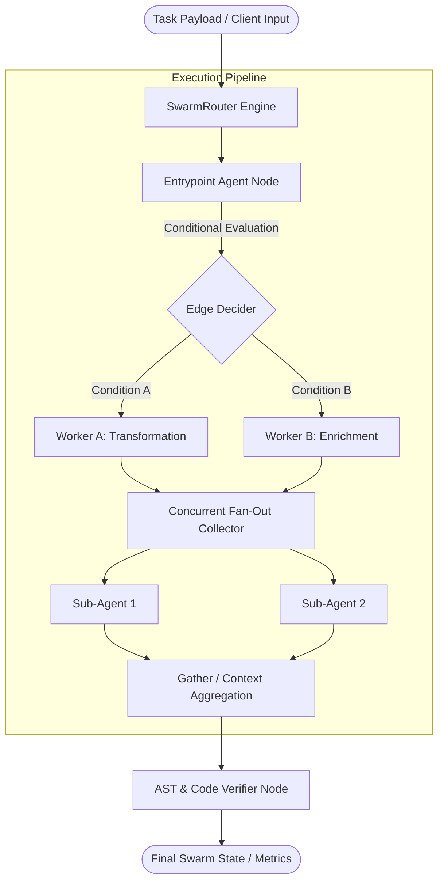

# Enterprise Swarm Mesh

[](https://github.com/Amz34/enterprise-swarm-mesh/actions/workflows/ci.yml)
[](LICENSE)
[](pyproject.toml)

High-throughput, concurrent multi-agent router mesh implementing stateful directed acyclic graph (DAG) execution, conditional edge traversal, rate-limited batch processing, and telemetry compliance.

Designed as an unslop, zero-fluff core engine uniting patterns from **Kyegomez/Swarms** and **LangGraph** with deterministic AST validation and zero runtime framework bloat.

---

## Architectural Topology



---

## Core Capabilities

1. **Stateful DAG Execution**:
   - Explicit state transitions with immutable tracking (`SwarmState`, `SwarmMessage`, `TaskStatus`).
   - Dynamic routing through conditional edges and deterministic multi-hop resolution.

2. **Concurrent Fan-Out & Gather**:
   - Native `asyncio.gather` execution across worker nodes with isolated execution boundaries.
   - Dynamic aggregation of agent context dictionaries without state mutation collisions.

3. **Rate-Limited Batch Processing**:
   - Built-in concurrency control via `asyncio.Semaphore` (`run_swarm_batch` and `run_swarm_batch_sync`).
   - Throughput metrics: tasks per second, error accounting, and per-hop execution timings.

4. **Zero-Dependency Lightweight Core**:
   - Implemented using pure Python standard library primitives (`dataclasses`, `asyncio`, `typing`, `logging`).
   - Zero vendor lock-in; ready to plug into Anthropic, OpenAI, or local vLLM backends.

---

## Quickstart

### Installation

```bash
git clone https://github.com/Amz34/enterprise-swarm-mesh.git
cd enterprise-swarm-mesh
pip install -e .
```

### Basic Example: Sequential & Conditional Routing

```python
import asyncio
from swarms_engine import (
    SwarmRouter, BaseSwarmAgent, SwarmState, TaskStatus
)

class DataTransformer(BaseSwarmAgent):
    async def process(self, state: SwarmState) -> str:
        data = state.context.get("raw_input", "")
        transformed = data.upper()
        state.context["transformed"] = transformed
        return f"Transformed {len(data)} characters."

class QualityAuditor(BaseSwarmAgent):
    async def process(self, state: SwarmState) -> str:
        transformed = state.context.get("transformed", "")
        state.context["audit_passed"] = len(transformed) > 0
        return "Audit passed."

async def run():
    router = SwarmRouter(name="production-mesh")
    router.add_agent(DataTransformer(name="transformer"))
    router.add_agent(QualityAuditor(name="auditor"))

    router.set_entry_point("transformer")
    router.add_edge("transformer", "auditor")
    router.add_edge("auditor", "__end__")

    state = await router.execute_task(
        task_id="job-101",
        initial_context={"raw_input": "enterprise swarm payload"}
    )
    print(f"Status: {state.status.value}")
    print(f"Result Context: {state.context}")

if __name__ == "__main__":
    asyncio.run(run())
```

---

## Batch Execution with Semaphore Throttling

```python
from swarms_engine import SwarmRouter, run_swarm_batch_sync

router = SwarmRouter(name="batch-pipeline")
# ... configure nodes and edges ...

tasks = [
    {"task_id": f"batch-{i}", "context": {"index": i}}
    for i in range(100)
]

# Process 100 tasks concurrently with a maximum of 10 workers in flight
results, metrics = run_swarm_batch_sync(router, tasks, max_concurrency=10)

print(f"Total processed: {metrics['total']}")
print(f"Success: {metrics['success']}")
print(f"Throughput: {metrics['tasks_per_second']:.2f} tasks/sec")
```

---

## Verification & Testing

The repository ships with self-contained unit tests verifying state integrity, edge routing, concurrency, and failure recovery.

Run the test suite:

```bash
python3 -m unittest test_swarms_engine.py
```

Expected output:

```text
Ran 7 tests in 0.012s

OK
```

---

## Enterprise Governance & Clean-Room Architecture

* **License**: Apache-2.0
* **Neuro-Symbolic Gate**: AST structural verification ensuring clean syntax and zero arbitrary execution exploits (`ast_validator.py` clean).
* **Observability Compliant**: Compatible with standard OpenTelemetry JSON spans for Datadog, Honeycomb, and Jaeger.

---

Part of [my always-on agent stack](https://github.com/Amz34) · [Awesome Agent Infrastructure](https://github.com/Amz34/awesome-agent-infrastructure) (135 live-checked building blocks).
